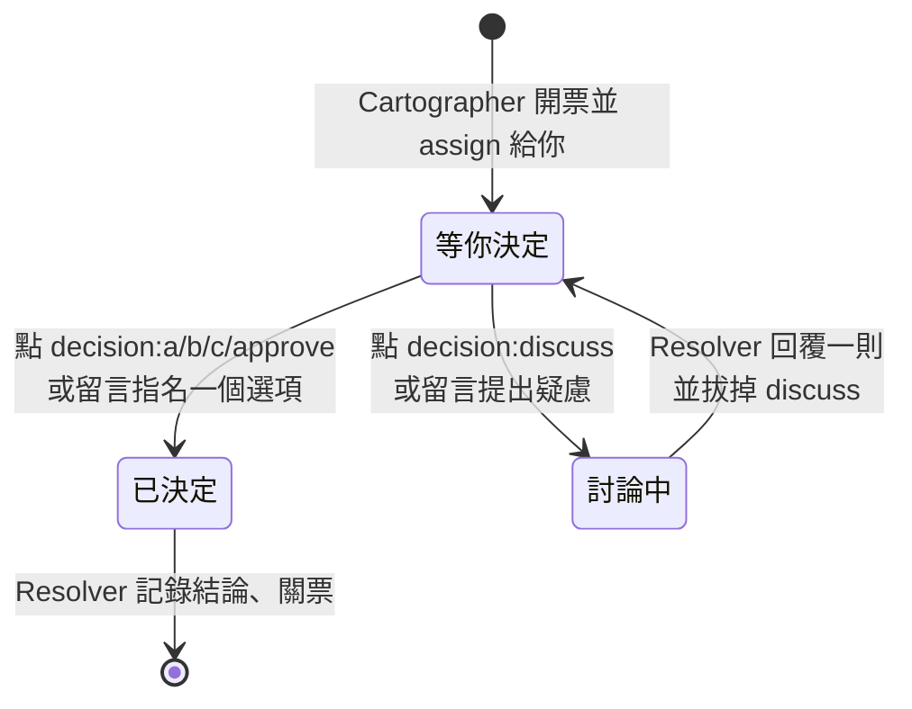

# 03 · 人類的一天

> 系統跑起來之後,人類的日常只有三個動作。其他一切(開票、查證、寫 code、開 PR、看板欄位)都是機器的事。

---

## 動作一:看看板最左邊那一欄

打開 org 的 Project 看板,最左欄是 **⏳ 等你決定**。那一欄有卡片才需要你;空的就關掉。

每條 loop 每一輪結束都會回報「還在等你的票」。它催你,就是它在工作。

## 動作二:讀決策封包,點一個 label

點進卡片(看板右側面板會展開整張 issue),讀完決策封包,在 Labels 區點一個:

| Label | 意思 | 之後會發生什麼 |
| --- | --- | --- |
| `decision:a` / `b` / `c` | 選 A / B / C | Resolver 幾分鐘內記錄結論、關票、通知 map |
| `decision:approve` | 採用封包的建議 | 同上 |
| `decision:discuss` | 有疑慮,想聊 | 卡片移到 **💬 討論中**;Resolver 回覆後拔掉 label,卡片落回 **⏳ 等你決定** |

**也可以直接留言。** 沒有 `🤖 [` 開頭的留言都是人類發言。留言明確指名一個選項(「選 B」「照建議」)時,Resolver 會把它轉錄成 label 再結案,並引用你的原句;拿不準的一律當成想討論,寧可多問一輪,也不替你決定。

選項超過 A/B/C 的票(封包會標成 A–E),用留言回選項字母。

聊到發現整張票問錯了問題,就把票關成 **Not planned**,Cartographer 會把它退回地圖的霧裡重新規劃。

## 動作三:審「👀 待你 review」的那一張 PR

每張實作票的 PR **不進 main**,而是進那份 spec 的整合分支。通過驗證後由 Implementer 自己合併、關票、解鎖下一批;這些 PR 不會出現在「👀 待你 review」,看板上顯示「⚡ 實作中」。

整份 spec 的票全部收割完,Implementer 開**一張** spec→main 的 PR。這一張才進「👀 待你 review」。它的 body 依序有:

1. **Merge Danger 彙整**:每張批次 PR 的單向門/雙向門判斷;單向門逐條列成「**審這裡**」(PR、檔案、最壞情況)。
2. **Summary**:一張 Mermaid 圖,說明這份 spec 改變了什麼行為。
3. **驗證**:合進來的 main SHA、閘門指令與結果。
4. **未解疑點**:reviewer 留給人判斷的問題。

你只要細看「審這裡」列出的地方,其餘快速掃過。Implementer 的輪末回報會明講「落後 main 0 個 commit、閘門綠」,這句話成立才代表可以合併。**合併進 main 永遠由人做。**

## 丟新想法進系統

在 planning repo 開一張 issue,**什麼 label 都不用加**,把模糊的想法寫下來就好。不用知道它歸前端還是後端,那是管線自己會回答的問題。

也可以從看板直接丟:**+ Add item** 打完字後,對那張卡按 **Convert to issue → 選 planning**。

> ⚠️ 沒有 convert 的 draft 只存在看板上,機器永遠看不到它。

開好的想法會出現在「💡 收件匣」欄;Cartographer 下一輪會把它變成地圖(移到「🗺️ 規劃中」)與第一批決策票。

## 給 PM / SA:你完全不需要離開看板

1. **丟想法**:在 planning 開 issue(手機 GitHub app 也行)
2. **做決策**:看板點卡片 → 右側面板讀封包 → Labels 點一個 `decision:*` → 關掉面板
3. **有疑慮**:面板裡留言 + 點 `decision:discuss`,agent 會回覆在同一張卡上

你需要的權限只有 planning repo(write)和這個 Project;code repo 完全不用碰。

## 原型票:你說「畫」它才畫

文字講不清楚的介面問題,Cartographer 會開 `wayfinder:prototype` 票,附上選項並 assign 給你。**你沒開口,Prototyper 不會動手。** 在票上留言「先畫 V1」「A 和 B 都畫出來看看」,下一輪它就會交付:

- 一個手機上點得開的原型頁(底部有切換器可以切情境)
- 一個截圖圖庫頁
- 它做原型時發現的事,以及對票上每一題的初步建議

看完直接在票上回「這個對、那個不對」,Resolver 會記錄結論並關票。

## 出狀況看哪裡

- **🚫 卡住**欄 = 錯誤旗標。點進去看 `🤖 [...]` 留言寫的卡點。
- 看板拖不動是特性,不是 bug:欄位由 label 算出來,要改狀態就到 issue 上操作 label、assignee 或關票。

> 下一步:[04 · 六個角色](04-roles.md)
