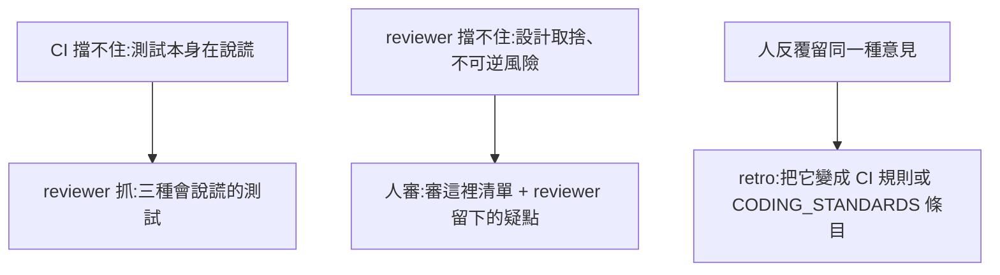

# 06 · 品質的三層把關

> 開 PR 變便宜之後,值得審的 PR 並沒有變多。這一篇說明 wayfinder-loops 怎麼在人類審查之前,把品質拉到「值得審」的程度。

---

## 三層,由便宜到昂貴

| 層 | 花什麼 | 擋什麼 | 在哪裡 |
| --- | --- | --- | --- |
| 1. 本地確定性檢查 | CPU | lint、型別、測試、架構規則能抓到的錯 | 實作 subagent push 前、reviewer 修完後、收割前各跑一次 |
| 2. 獨立 reviewer | token | 違反標準、做錯規格、會說謊的測試 | 每張批次 PR 一個全新的 reviewer agent |
| 3. 人類審查 | 人的時間 | 不可逆的風險 | 每份 spec 一次,只細看單向門 |

## 第一層:本地確定性檢查

每個 code repo 在 `wayfinder.yml` 設一個 `ci` 指令,它必須跟 GitHub 上的 CI 檢查同一組東西(例如 `make ci`、`pnpm check`)。需要 docker 的整合測試放在 `ci_optional`,docker 可用時才加跑。

批次 PR 的驗證**不靠 GitHub Actions**。你的 CI 可能只對 base 是 main 的 PR 觸發,也可能每個 PR 都跑;不管哪一種,批次 PR 上的 check 都不作為收割依據。理由是:收割前要驗的是「這張 PR 合進整合分支最新 HEAD 之後」的組合,GitHub 上的 check 驗的是 PR 開的當下。

同一張批次 PR 會被驗三次:

1. 實作 subagent push 之前。
2. reviewer 修完之後。
3. 收割前,在本地把它合進整合分支的最新 HEAD 再跑一次。**不信前兩次的自述。**

## 第二層:獨立 reviewer

### 為什麼要拆成兩個 context

實作者的 context 塞滿了探索、寫 code、除錯的過程,再要求它守 coding standards,效果最差。reviewer 只拿到 diff,context 最乾淨,標準放在這裡才守得住。

**實作負責「能動」,審查負責「變好」。** 這跟 TDD 的 red-green-refactor 分開兩步是同一個道理。所以實作 subagent 刻意**不跑** code review,也**不讀** `CODING_STANDARDS.md`。

### 審查依據

reviewer 只用這四個來源,不加個人偏好:

1. 該 repo 的 `CODING_STANDARDS.md`(選用,規則編號 R-xx)
2. 票的 body:有沒有做到票要的、有沒有做票沒要的
3. 三種會說謊的測試(下面說明)
4. mattpocock code-review 內建的 Fowler code smell baseline

### 三種會說謊的測試

| 類型 | 長什麼樣子 | 為什麼是謊 |
| --- | --- | --- |
| Tautological | `assert TTL_SECONDS == 1800`,而 1800 就是那個常數的定義 | 除非有人改那行字面值,否則永遠不會失敗 |
| Structure-sensitive | 讀原始碼字串比對、斷言私有屬性、斷言 mock 的呼叫順序 | 行為不變的重構會讓它壞;真的壞掉時它反而照樣綠 |
| Cannot-fail | 把被測對象的關鍵依賴整個換成 `AsyncMock`,只斷言「它被呼叫了」 | 真實的失敗路徑不可能被觸發 |

### 直接修,不留一堆 comment

reviewer 預設**直接 commit 修正**,不把一長串意見丟給人消化:

- **違規明確、修法唯一、範圍在 diff 內** → 直接修,一個問題一個 commit,commit 以 `review: <R-xx|spec|test|smell|arch>` 開頭。
- **設計取捨、超出 diff、拿不準** → 不修,在 PR 留言,最多 5 條,每條附檔案與行號。
- **規格嚴重不符** → 不修,退回票、貼 `agent:blocked`。

修完要重跑本地 CI。如果是自己的修正把 CI 弄紅,就 `git revert` 那個 commit,改列為疑點。reviewer 永遠不會讓一張綠的 PR 變紅。

**reviewer 禁止**:為了讓測試通過而弱化斷言、新增 mock 繞過失敗、改 diff 以外的檔案、改標準文件本身、改 CI 設定。

`review:` 前綴同時是之後 retro 的資料來源:統計哪條規則最常被修,就知道哪裡該加一個機械檢查。

## 第三層:人類只審一次,而且知道審哪裡

### Merge Danger

reviewer 對每張批次 PR 判斷:

```
## Merge Danger
- Door:one-way / two-way(一句理由)
- 波及範圍:局部 / 模組 / 全系統
- 最壞情況:<一句>
```

只要碰到單向門清單任一項,就是 one-way。預設清單:資料庫 migration、資料刪除或不可逆改寫、權限字串或認證、對外發送(email、webhook、推播)、金流、公開 API 契約。各組織可以在 `wayfinder.yml` 的 `one_way_doors` 追加,例如「寫回 ERP」。

### 審這裡

integrate 票開 spec→main PR 時,把所有批次 PR 的 Merge Danger 彙整成表,單向門逐條列成「審這裡」:PR 編號、檔案路徑、最壞情況。全部是雙向門,就明講「這份 spec 沒有單向門」。

人拿到的不是「42 個檔案改了 1,800 行」,而是「這三個地方請細看,其餘可以快速掃過」。

## 每一層擋不住的,交給下一層



最後一列是[路線圖](11-roadmap.md)上的 retro:同一則審查意見,不應該寫第二次。

> 下一步:[07 · Label、看板與不變式](07-labels-board.md)
